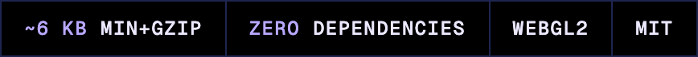
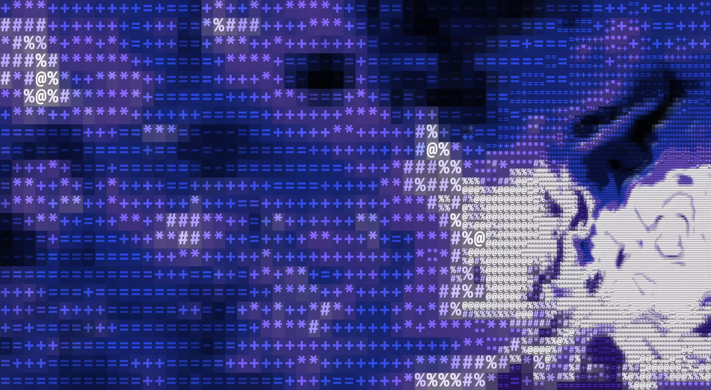
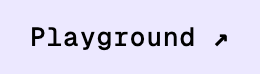
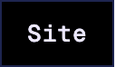
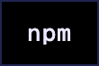
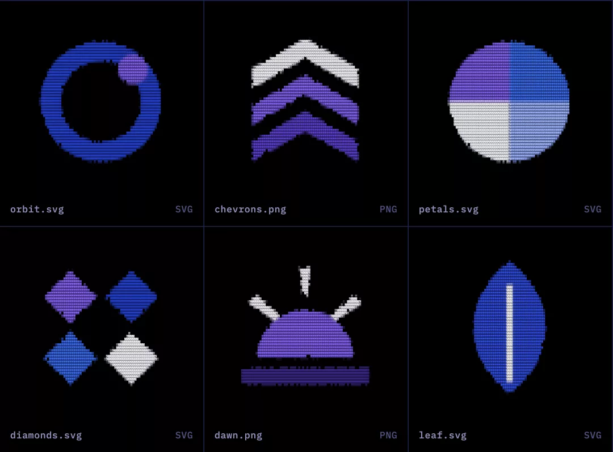
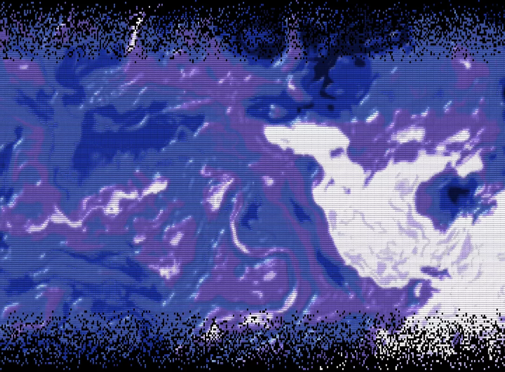
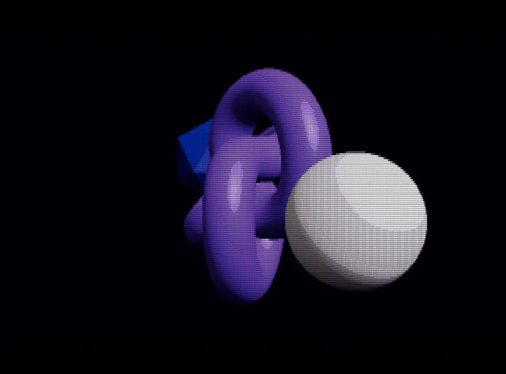

<h1 align="center">asciipaint</h1>

<p align="center">Paint any image, video, canvas or three.js scene as fine, coloured ASCII glyphs on WebGL2.<br>From a distance it reads as a painting; up close it is text.</p>

<p align="center"></p>

<p align="center"><a href="https://asciipaint.prafficoding.workers.dev"></a></p>

<p align="center">
  <a href="https://asciipaint.prafficoding.workers.dev/playground/"></a>
  <a href="https://asciipaint.prafficoding.workers.dev/docs/quick-start/"></a>
  <a href="https://asciipaint.prafficoding.workers.dev"></a>
  <a href="https://www.npmjs.com/package/asciipaint"></a>
</p>

## Install

```sh
npm i asciipaint        # or: pnpm add asciipaint / yarn add asciipaint / bun add asciipaint
```

Deno: `import { asciipaint } from "npm:asciipaint"`.

No bundler? Load it from a CDN:

```js
import { asciipaint } from "https://esm.sh/asciipaint"; // or cdn.jsdelivr.net/npm/asciipaint, unpkg.com/asciipaint
```

`three` is an optional peer dependency (`>=0.170`), needed only for `asciipaint/three` (plus `@types/three` in TypeScript).

The default font, Geist Mono, is not bundled: load it yourself (for example from Google Fonts), or the glyphs fall back to `ui-monospace`.

## Use

|                                                                  `<ascii-img>`                                                                  |                                                      Any image, video or canvas                                                      |                                                              A three.js scene                                                               |
| :---------------------------------------------------------------------------------------------------------------------------------------------: | :----------------------------------------------------------------------------------------------------------------------------------: | :-----------------------------------------------------------------------------------------------------------------------------------------: |
|  |  |  |

The one-line path, an image as an element:

```html
<script type="module">
  import "asciipaint/element";
</script>
<ascii-img src="/logos/claude.svg" alt="Claude" width="120" height="120"></ascii-img>
```

Attributes: `src`, `alt`, `width`, `height`, `background`, `edge-fade`, `cell` (`"2.4 3.4"`), `ramp`. Changing one repaints. `edge-fade` defaults to 0 and `background` to the first non-transparent `background-color` up the ancestor chain (white if none), which is also used when `background` isn't an opaque colour. Every element shares one WebGL context. Like ``, it fires `error` when its image fails to load; it fires `paint` after each paint.

Any image, video or canvas:

```ts
import { asciipaint, autoRender } from "asciipaint";

const paint = asciipaint(canvas, { cell: [2.4, 3.4], ramp: "-=+*#%@" });
paint.draw(source); // image | video | canvas | ImageBitmap | VideoFrame
paint.set({ background: "#F4EEDF", sparkle: true, edgeFade: 0.076 }); // live, no rebuild
paint.resize(); // or let autoRender do it
paint.dispose();

// ~30 fps, pauses off screen and in a hidden tab, honours reduced motion
const loop = autoRender(paint, () => paint.draw(video), { onContextLost: () => showFallback() });
loop.requestFrame(); // the only frame source under reduced motion
loop.stop();
```

A three.js scene, on the renderer's own canvas and context:

```ts
import { asciipaintThree } from "asciipaint/three";

const paint = asciipaintThree(renderer, options);
paint.render(scene, camera); // replaces renderer.render(scene, camera)
await paint.compile(); // optional: compile the shaders up front, without blocking
```

It always tone-maps with ACES Filmic at `renderer.toneMappingExposure` and outputs sRGB, whatever `renderer.toneMapping` and `outputColorSpace` say; set `renderer.toneMapping = ACESFilmicToneMapping` if you want the raw render to match. The scene's alpha is ignored: every cell is covered.

Tip: set `background` to the colour at your source's edges. On a dark source the default cream edge fade speckles.

## Options

| Option       | Default                                              | Meaning                                                                                |
| ------------ | ---------------------------------------------------- | -------------------------------------------------------------------------------------- |
| `cell`       | `[2.4, 3.4]`                                         | CSS px per glyph cell, `[width, height]`                                               |
| `ramp`       | `"-=+*#%@"`                                          | Glyphs from dark to bright, 2 or more, spread across the full brightness range         |
| `font`       | `'600 "Geist Mono", ui-monospace, Menlo, monospace'` | Any loaded monospace font: weight and family; any size is ignored                      |
| `background` | `"#F4EEDF"`                                          | The paper the art sits on: an opaque CSS colour or `[r, g, b]` in 0-1. Live via `set`  |
| `edgeFade`   | `60 / 790` (about 0.076)                             | Dithered dissolve depth as a fraction of the width; 0 is a hard edge. Live via `set`   |
| `sparkle`    | `false`                                              | Bright isolated points become `*` / `+` in their own colour, with glow. Live via `set` |
| `dpr`        | device pixel ratio, capped at 3                      | Not available on `asciipaintThree`, which follows the renderer                         |

The source is cover-fitted to the canvas: it fills the canvas, keeps its aspect ratio and crops the overflow. Sources keep their alpha, and partly transparent cells fade into `background`. SVGs, and images smaller than the sample grid, are rasterised at the sample size so small icons stay crisp.

## Limits

- It paints pixels. It cannot render arbitrary HTML or CSS components; draw them to a canvas first.
- Images and videos from another origin need CORS headers (`Access-Control-Allow-Origin`), and an `` you pass needs `crossOrigin = "anonymous"`; WebGL can't read them otherwise.
- WebGL2 is required (every current evergreen browser). `asciipaint` throws if the context is unavailable.
- Browser only. Importing it on the server does not crash and does nothing, but call it from client-side code (for example `useEffect`, or an Astro island).

## License

MIT
